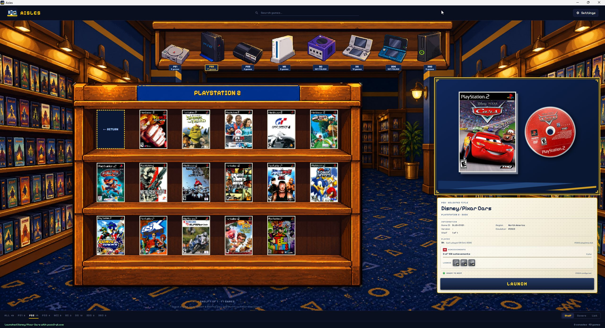
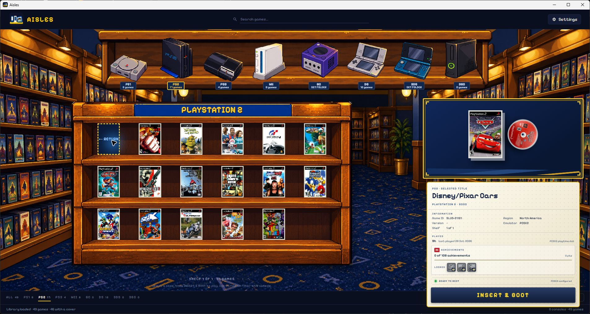

# Aisles

A Windows front end for browsing and launching games across different emulators,
with the feel of a pixel-art video rental store. Bring your local libraries
together, browse by console, and launch each game with its configured emulator.

[Download the latest release](https://github.com/MikeGonzaBar/Aisles/releases/latest) ·
[Release history](https://github.com/MikeGonzaBar/Aisles/releases) ·
[Report an issue](https://github.com/MikeGonzaBar/Aisles/issues)

## Screenshots

### Shelf

Console sprites sit above a three-level game cabinet. Select a case to inspect
its box, disc or cartridge, game information, and launch controls.



The same interface adapts to smaller desktop windows:



**Covers** offers a cover grid, and **List** offers compact rows for browsing
larger libraries. Screenshots of these two views are not yet included here.
The captures above predate the latest typography and selected-case card changes.

## Features

- **Three browsing views:** Shelf, Covers, and List, with console filtering and search.
- **A rental-store presentation:** pixel console sprites, platform-specific case
  proportions, and full-resolution selected-game artwork.
- **Per-console setup:** choose game folders, emulator executables, artwork
  folders, and an optional RetroArch core from Settings.
- **Game details:** local metadata, emulator-owned play time and history where
  available, and launch-readiness information.
- **Artwork:** local covers, online artwork lookup, and persistent artwork choices.
- **Achievements:** optional RetroAchievements progress for supported integrations
  and local RPCS3 trophy progress for PlayStation 3.
- **Keyboard browsing and reduced motion:** navigate games with the keyboard and
  respect the system's reduced-motion preference.

## Download and installation

1. Open the [latest release](https://github.com/MikeGonzaBar/Aisles/releases/latest).
2. Download `Aisles-Setup-<version>.exe` and run the installer.
3. Launch Aisles from the Start menu or the optional desktop shortcut.

The release package targets **Windows x64** and includes the .NET and Windows
App SDK runtimes. The interface requires Microsoft Edge WebView2 Runtime.
The project declares Windows 10 version 1809 as its minimum target; compatibility
across Windows versions has not been fully verified. Linux and macOS builds are
not provided.

Install and configure your emulators separately. Games, BIOS/firmware, emulator
executables, and RetroArch cores are not included.

Release pages contain version information and an attached `changes.md`.

## Getting started

1. Install an emulator from the supported integrations below and confirm that
   your game runs directly in it.
2. Open **Settings** in Aisles and select the console you want to configure.
3. Set its **games folder** and **emulator executable**. Optionally choose an
   artwork folder; for RetroArch DS, also choose the compatible core DLL.
4. Save. Aisles rescans the library without restarting.
5. Select the console, browse in **Shelf**, **Covers**, or **List**, and use search
   to narrow the active library.
6. Select a game and choose **Launch** / **Insert & Boot**.

The shipped catalog contains example paths from the development machine.
Replace them with your own paths before scanning and launching games.

## Supported systems and emulators

These integrations are implemented in the current catalog. Support here means
Aisles can discover the specified library layout and pass a launch target to the
configured emulator; it does not guarantee every game or emulator version works.

| Console | Configured emulator | Current discovery format or layout |
|---|---|---|
| PlayStation | DuckStation | `.cue` files, including subfolders |
| PlayStation 2 | PCSX2 | `.iso` files directly in the games folder |
| PlayStation 3 | RPCS3 | Disc folders containing `PS3_DISC.SFB`, plus bootable installed games from the configured installed-games folder |
| GameCube | Dolphin | `.iso`, `.rvz`, `.gcm` files directly in the games folder |
| Wii | Dolphin | `.rvz` files directly in the games folder |
| Nintendo DS | RetroArch + melonDS DS core | `.nds` files, including subfolders |
| Nintendo 3DS | Citra | `.3ds`, `.cci`, `.cia` files directly in the games folder; installation/boot requirements remain emulator-specific |
| Xbox 360 | Xenia Canary | Extracted game folders containing `default.xex`; ISO discovery is not implemented in this scan mode |

The emulator profile layer also recognizes standalone **DeSmuME** for DS.
The default DS launch template uses RetroArch's `-L` and `{core}` arguments;
changing to a standalone emulator requires adjusting the catalog's arguments,
not just selecting another executable. Standalone DeSmuME does not enable the
DS RetroAchievements integration.

RetroAchievements progress is available for PS1, PS2, GameCube, Wii, and DS
with a compatible RetroArch core. PS3 uses local RPCS3 trophies instead.
3DS and Xbox 360 achievement integrations are not implemented.

## Known limitations

Aisles is in active development. The repository contains an earlier PS1 launch
verification and tests for settings, metadata/play-time parsing, emulator profiles,
RetroAchievements, and PS3 trophies. Full game launches have **not been verified
across all eight platforms with the latest interface**. The recorded checks do
not establish real-game launch verification for 3DS or Xbox 360.

Popular systems without shipped integrations include NES, SNES, Nintendo 64,
Game Boy / Game Boy Color / Game Boy Advance, PSP, PlayStation Vita, Wii U,
Nintendo Switch, original Xbox, Xbox One / Series, PlayStation 4 / 5, Sega
consoles, and arcade boards. Examples of emulators not currently integrated
include PPSSPP, Vita3K, Cemu, xemu, MAME, and standalone melonDS.
RetroArch support is currently configured for DS; it does not imply support for
every RetroArch core or system.

Artwork and metadata coverage vary by game and platform. Play-time and
achievement information depends on data available from the configured emulator
or service. Adding a catalog entry alone does not establish a fully tested new
system integration.

## Settings and local data

Aisles stores application data under `%LOCALAPPDATA%\Aisles`.
Per-console path overrides live in `settings.json`; rebuilding or updating the
application does not replace those overrides. The `consoles.json` file beside
the executable provides the default catalog and advanced launch templates.

RetroAchievements is optional. In **Settings → RetroAchievements**, enter your
username and web API key, test the connection, then save. Credentials are stored
locally in `retroachievements.json`; the key is not returned to the web interface.
Use **Unlink** and save to remove the saved credentials. PS3 trophies require no
PSN account.

Online artwork lookup, RetroAchievements, and emulator update checks make network
requests to their respective providers. Local configuration and downloaded artwork
are kept on your PC.

To back up Aisles data, close the app and copy `%LOCALAPPDATA%\Aisles` to a safe
location. That backup may include account credentials. To reset path overrides,
close Aisles and rename `settings.json`, then configure your paths again.
Emulator saves and game files must be backed up separately.

## Help and feedback

| Problem | What to check |
|---|---|
| No games appear | Confirm the games folder exists and matches the discovery layout above; save Settings to rescan. |
| A game will not launch | Check the executable and game paths, launch readiness, and any required core. Try the same game directly in the emulator. |
| Artwork is missing or incorrect | Check the artwork folder and game identity; use the game's artwork controls to review available choices. |
| Play time or achievements are absent | Confirm the emulator has recorded the relevant data and that the integration supports it. For RetroAchievements, test the account connection. |

Report bugs and request features through
[GitHub Issues](https://github.com/MikeGonzaBar/Aisles/issues).
Include the Aisles release version, Windows version, console, emulator/version,
steps to reproduce, and the visible error. Screenshots help with interface bugs;
remove credentials and private paths before sharing files or images.

## Development

Build on Windows with the **.NET 10 SDK** and the Windows App SDK runtime:

```powershell
dotnet build Aisles.slnx -c Debug
dotnet run --project src/Aisles.App
```

See the [developer guide](docs/development.md) for the code layout, test commands,
release workflow, branding tools, and historical implementation documents.
For contributions, describe the problem and intended change in an issue or pull
request, include reproduction or verification steps, and keep credentials and
local configuration out of commits.

## License and credits

A project-wide license has not yet been declared in this repository.
Third-party code and assets retain their own licenses and attribution requirements:

- [Pixelify Sans license](src/Aisles.App/wwwroot/art/pixel-ui/PixelifySans-OFL.txt)
- [Departure Mono license](src/Aisles.App/wwwroot/art/pixel-ui/DepartureMono-LICENSE.txt)
- [Legacy console-model provenance and attribution](assets/models/ATTRIBUTION.md)

Console and emulator names identify the systems and applications Aisles works with.
Their names, logos, and game artwork belong to their respective owners.
