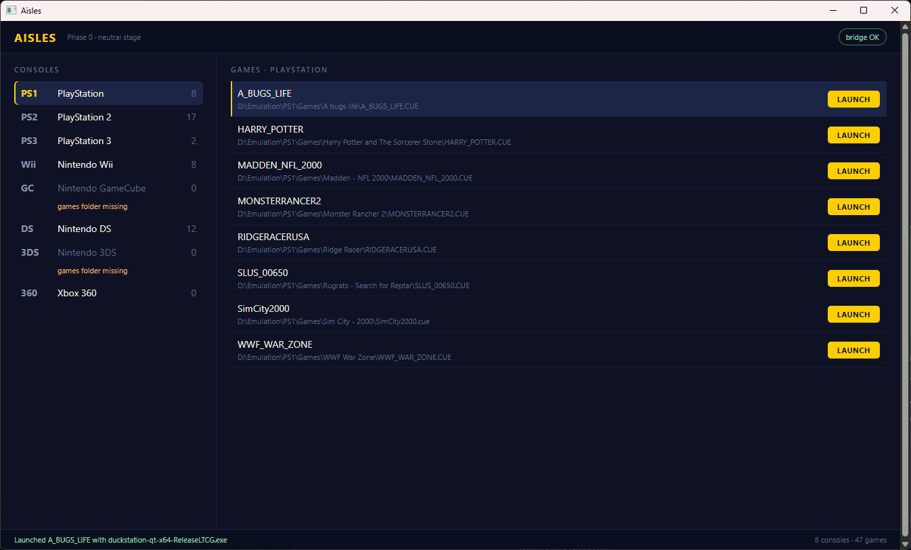

# Phase 0 verification

Acceptance evidence for Phase 0 (PLAN.md §7), captured from the running app.

## What was run

```powershell
dotnet build Aisles.slnx -c Debug
src/Aisles.App/bin/x64/Debug/net10.0-windows10.0.19041.0/Aisles.exe
```

Shell is WinUI 3, unpackaged, on .NET 10 against Windows App SDK 2.0.1. The build
is clean: 0 warnings, 0 errors.

## Shell and bridge

The window hosts WebView2. The page is served over a virtual host
(`https://aisles.local`) mapped to the app's `wwwroot` rather than `file://`, so it
stays a normal https origin.

The badge reads `bridge OK`. That only happens after the web layer posts `ready` and
the host answers with `library`, so the round trip is proved rather than assumed.

## Library

`consoles.json` resolved to **8 consoles / 47 games**:

| Console | Games | Shape |
|---|---|---|
| PlayStation | 8 | `CuePerFolder` |
| PlayStation 2 | 17 | `FlatFiles` |
| PlayStation 3 | 2 | `DiscFolders`, anchored on `PS3_DISC.SFB` |
| Nintendo Wii | 8 | `FlatFiles` |
| Nintendo GameCube | 0 | no games folder exists |
| Nintendo DS | 12 | `FileInFolder` |
| Nintendo 3DS | 0 | no games folder exists |
| Xbox 360 | 0 | folder exists, holds no games |

PlayStation 3 resolving to 2 games rather than 4 confirms the decoy `PARAM.SFO`
handling described in §3.1.

## Launch

Driven through the real UI rather than by calling the launcher: the first game row's
LAUNCH button was clicked over the WebView2 DevTools protocol, so the path proved is
button → bridge → host → process.

The host started:

```
"C:\Emulation\Duckstation\duckstation-qt-x64-ReleaseLTCG.exe" "D:\Emulation\PS1\Games\A bugs life\A_BUGS_LIFE.CUE"
```

and the web layer reported the outcome back:

```
Launched A_BUGS_LIFE with duckstation-qt-x64-ReleaseLTCG.exe
```



## Known gaps at this point

- Titles are derived from filenames, which is why a row reads `A_BUGS_LIFE` and
  another reads `SLUS_00650`. Phase 1 replaces them with real titles.
- Xbox 360's folder exists but holds no games, so it shows `0` without the
  "games folder missing" flag that GameCube and 3DS get.
