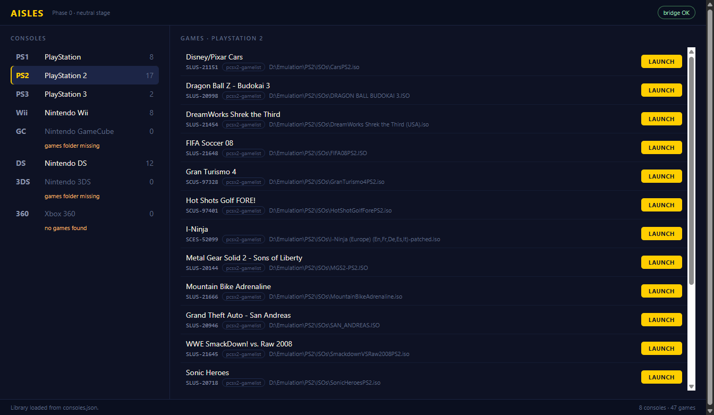
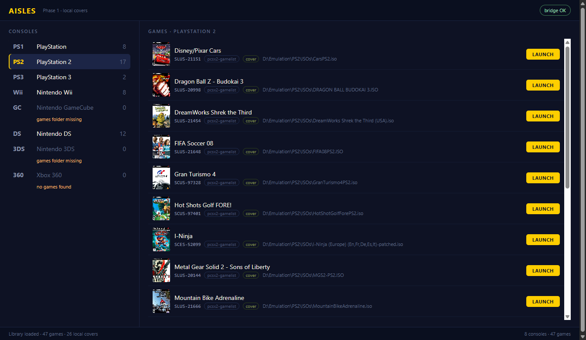

# Phase 1 discovery: titles, serials and cover art

Verified against the real 47-game library by reading the resolved payload out of the
running app (`artifacts/phase1/library.json`) and screenshotting each console.

## The finding that shaped the design

The name a person gave a folder beats anything stored inside the file. Measured on this
machine:

| Platform | What the file says | What the folder says | Better |
|---|---|---|---|
| PS1 | `SLUS_00650.CUE` | `A bugs life` | folder |
| DS | ROM header `COOKINGMAMA3` | `4309 - Cooking Mama 3 - Shop & Chop (US)` | folder |
| PS3 | `PARAM.SFO` TITLE `LittleBigPlanetT` | `LittleBigPlanet (USA) (En,…) (v02.00)` | folder |
| PS2 | `SAN_ANDREAS.ISO` | *(flat files, no folder)* | PCSX2 cache |

So emulator metadata is used to *replace* a derived name only where it is genuinely
authoritative — the PCSX2 game list cache — and to supply the serial wherever one exists.

## Resolution rules

| Scan shape | Title from | Serial from |
|---|---|---|
| `CuePerFolder` | containing folder name | — |
| `FileInFolder` | containing folder name | DS ROM header game code |
| `DiscFolders` | disc folder name | `PS3_GAME\PARAM.SFO` `TITLE_ID` |
| `FlatFiles` | file name | PCSX2 cache, when one sits beside the emulator |

`TitleNormalizer` then strips scene entry numbers (`2269 - `), region tags (`(USA)`, `(E)`),
language lists (`(En,Fr,Es)`), revisions (`(Rev 2)`), versions (`(v02.00)`) and `-patched`,
and turns an underscore followed by a space into a colon. `(Disc 1)` is never stripped,
because collapsing a two-disc set into one entry would be worse than the extra noise.

Entries using scene naming (`2269 - Iron Man (E)(SQUiRE)`) additionally drop leftover
release and dumper groups, which is how `(SQUiRE)` and `(XenoPhobia)` disappear.

## Result

47 games, 31 carrying a serial, every title either a cleaned name or an authoritative cache
title:

```
PS1   A bugs life · Harry Potter and The Sorcerer Stone · WWF War Zone        [name]
PS2   SLUS-20946  Grand Theft Auto - San Andreas                     [pcsx2-gamelist]
PS3   BCUS98148   LittleBigPlanet                                             [name]
Wii   Mario Kart Wii · New Super Mario Bros. Wii                               [name]
DS    B3CE        Cooking Mama 3 - Shop & Chop                                 [name]
```



Notes worth keeping:

- The cache also repairs names: `SusukiSuperBikesPS2.iso` resolves to "Suzuki TT
  Superbikes - Real Road Racing" (SLUS-20912), fixing a typo in the file name.
- The PCSX2 cache is read as evidence, never as a contract. It is parsed by walking
  length-prefixed string triples rather than assuming a fixed record layout, so a future
  PCSX2 format change makes it stop contributing instead of breaking the app.
- The `pcsx2-gamelist` / `name` chip on each row is provenance, not decoration. Titles are
  derived rather than catalogued, so the rule that produced each one stays visible.

## Cover-art discovery

Artwork is resolved from this machine first (PLAN.md §3.3.1, precedence step 2). Two
shapes exist in the real libraries here, and both are named in `consoles.json` through an
optional per-console `artworkPath`, so adding a platform still needs no recompile:

| Console | Source | Named by | Resolved |
|---|---|---|---|
| PS1 | `Documents\DuckStation\covers` | title | 8/8 |
| PS2 | `…\pcsx2-v1.7.4981-windows-x64-Qt\covers` | disc serial | 17/17 |
| DS | `2269 - Cover.png` beside the ROM | sidecar | 1/12 |
| PS3 | — | menu art only | 0/2 |
| Wii | — | Dolphin's `GameCovers` folder is empty | 0/8 |
| GC / 3DS / 360 | — | no games | 0/0 |

**26 of 47 games carry a local case front.** A menu icon is not a case front, so the PS3
discs' `ICON0.PNG` and `PIC1.PNG` are deliberately not used (§3.3.1).

Matching runs strictest first, and the rule that won is kept on the result and shown on the
row, so a loose match can never pass for an exact one:

1. `serial` — normalized file name equals the serial (`SLUS-20946.jpg`).
2. `title` — normalized file name equals the normalized title.
3. `title-contains` — one normalized title contains the other (`Rugrats - Search for
   Reptar` inside `Nickelodeon Rugrats - Search for Reptar`).
4. `title-similar` — Sørensen–Dice over character bigrams ≥ 0.90. This exists for exactly
   one row in this library: *Sorcerer Stone* versus *Sorcerer's Stone*.

A cover stored beside the game (`source: sidecar`) beats a folder match, because it was put
there for that game. In a flat library the folder is shared with every other game, so a
sidecar there must name the game; only per-game folders accept a loose `- Cover`.

Files are referenced in place and served through one WebView2 virtual host per folder
(`games-<id>.aisles.local`, `art-<id>.aisles.local`), so the page uses plain `` tags
(§5.3). Nothing is copied and nothing in the emulator's folder is touched.



Evidence: `artifacts/phase1/phase1-artwork.json` and `phase1-artwork-*.png`. All 26 URLs
were loaded through a real `` in the running app — 26/26 loaded, 0 failed — and the
rendered rows were counted per console. Launching was re-checked after the change and still
starts `duckstation-qt-x64-ReleaseLTCG.exe "D:\Emulation\PS1\Games\A bugs life\A_BUGS_LIFE.CUE"`.

## Still open

- **Online artwork.** §3.3.1 steps 3–4 (exact platform/ID or serial, then title + platform +
  region) are not implemented. `tools/artwork-workshop.cjs` is the working prototype and
  still downloads into `.cache/artwork/`; nothing in the host touches the network.
- **Disc and cartridge labels.** Separate slots from the cover and currently zero locally;
  `docs/ds-cartridge-sticker-review.md` records the measured DS situation.
- **Wii and PS1 serials.** A Wii disc ID needs the RVZ container header and a PS1 serial needs
  the disc's `SYSTEM.CNF`. Neither affects titles. Wii serials would additionally unlock
  Dolphin's GameTDB cover cache by ID.
- **A test project.** The matching rules above are pinned by an integration check against the
  real library, not by unit tests; extracting `Aisles.Core` is the prerequisite.

