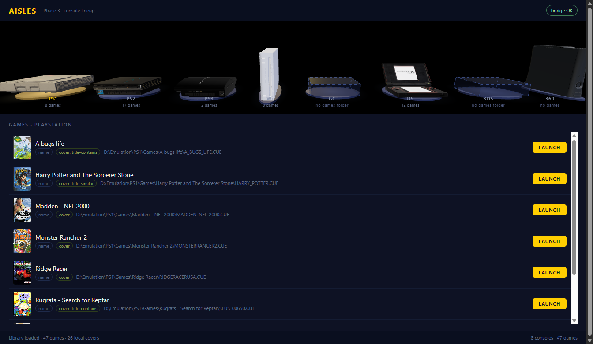

# Phase 3: the 3D console lineup

Verified in the running app by reading the live Three.js scene out of the page and
screenshotting it (`artifacts/phase3/`). Objective state, not just pixels:

```
lineup band 1329x210 · game row 71px
6 models loaded, 2 placeholders (GameCube, 3DS)
80 draw calls · 246,481 triangles · 34 textures · 21 shader programs
selected ps1 · spotlight x=-5.07 (slot x=-5.075) intensity=30
clicking the Wii slot -> selectedConsoleId = wii
0 page problems
```



## What the band does

The console strip is the platform switcher (PLAN.md §6). Every console in
`consoles.json` stands on its own plinth and pool of light with its short name and game
count beneath. The selected one is lifted, scaled 1.16×, given a warm pool and takes a
spotlight that slides to it. Hover lifts a console slightly and turns the cursor into a
pointer; a click goes back through `window.aislesSelectConsole`, the same path the list
uses. The camera is fixed and the stage holds still — no orbit, no zoom (§6).

Consoles with no games folder (GameCube, 3DS) still occupy their slot, drawn as a
dashed ghost box labelled *no games folder*, so the row reflects the catalog rather
than the models that happen to exist.

### Sizing and spacing

Each model is scaled so **the larger of its width and height** is `TARGET_SIZE` (0.80),
not so its longest axis is a constant. The camera is nearly head-on, so width and height
decide how big a console looks; normalizing by the longest axis let depth or height
dominate and left the Wii and Xbox 360 at a fifth of the PlayStation's presence. Depth is
capped separately (`MAX_DEPTH`) so a flat console does not stretch toward the viewer just
because it is wide.

Rotation is applied *before* the silhouette is measured, because the PS1 model is
authored along X: it is 0.19 wide and 0.29 deep, the inverse of a real PlayStation's
27 × 19 cm footprint, so without the yaw it would be scaled by the wrong axis and become
the widest thing on the stage.

Consoles are then packed left to right with a **fixed gap between their bounding boxes**
(`GAP`, 0.58), so the space a person sees is the same everywhere. Even centre spacing —
the obvious first approach — makes the gaps look wrong the moment two consoles differ in
width.

| Console | Screen width | Screen height |
|---|---|---|
| PS1 | 0.80 | 0.166 |
| PS2 | 0.80 | 0.207 |
| PS3 | 0.80 | 0.243 |
| Wii | 0.213 | 0.735 |
| DS | 0.80 | 0.472 |
| Xbox 360 | 0.215 | 0.80 |

Standing consoles therefore read as tall and narrow, flat ones as wide and low, with
every console occupying the same colour on the stage. Gaps measure 0.58 between every
neighbouring pair, tightening to 0.516 either side of whichever console is selected and
scaled up.

### Ground, light and camera

There is deliberately **no opaque ground plane**. The band's backdrop is a CSS gradient
showing through a transparent canvas; an opaque floor cuts that gradient with a hard
horizon, and any camera movement slides the horizon line under the consoles. A
`ShadowMaterial` plane receives the contact shadows and paints nothing else, so each
console appears to stand on its own patch of stage.

Each console has its **own pool of light**, sized to its footprint, built from one shared
white radial texture and tinted per slot. A single wide pool drawn across the row bands
every console in shared light and makes the row read as one object rather than eight.

The camera does not drift. It used to move on a slow sine, which moved every console
together and made the row read as one sliding object.

## The lineup LOD

The plan calls for two model tiers (§5.3). The full runtime models are unusable in a
row of eight: PS2 alone is 42 MiB and carries 22 textures, an estimated 469 MiB
decoded. A console in the lineup is ~100 px wide, so 256 px per texture is already
generous.

`tools/build-lineup-models.cjs` produces `assets/models/<id>/lineup.glb`:

| Console | Runtime | Lineup | Images |
|---|---|---|---|
| PS1 | 9.52 MiB | 1.06 MiB | 4 (all shrunk to ≤256) |
| PS2 | 42.15 MiB | 1.85 MiB | 22 (all shrunk) |
| PS3 | 3.44 MiB | 1.70 MiB | 2 (all shrunk) |
| Wii | 1.94 MiB | 1.94 MiB | 0 |
| DS | 2.88 MiB | 0.19 MiB | 3 (all shrunk) |
| Xbox 360 | 5.94 MiB | 5.94 MiB | 0 |
| **total** | **65.9 MiB** | **12.7 MiB** | 19.3% |

Geometry is untouched. The triangle counts (1k–160k) are irrelevant next to texture
memory, and the build verifies every non-image buffer view is byte-identical to the
runtime model. Images are re-encoded losslessly as PNG because PS1 and PS2 both carry
normal and occlusion maps, which do not survive a lossy pass.

Wii and Xbox 360 have no textures at all, so they are pure geometry and do not shrink.
That is visible in the numbers rather than hidden by them.

Models are normalized at runtime, not baked into the file: the largest dimension is
scaled to 0.82, the model is centred on X/Z and rested on the floor. The source models
ship in wildly different units, and this makes the row consistent regardless.

## Offline bundling

`tools/vendor-three.cjs` copies three.js 0.180.0 out of `node_modules` into
`src/Aisles.App/wwwroot/vendor/` — the module build, `three.core.min.js` (the module
build is a thin re-export over it), `GLTFLoader`, `BufferGeometryUtils`,
`RoomEnvironment` and the MIT licence. 856 KiB committed, no CDN, no npm install needed
to run.

The page uses an import map for `three` and `three/addons/`, so the addons' internal
`from 'three'` imports resolve unchanged. `stage3d.js` is a module; `stage.js` stays a
classic script because its top-level `state` is what the verification harness and any
future debugging session reads.

Reflections come from `RoomEnvironment` through `PMREMGenerator` rather than an HDRI
file, so the gloss reads correctly while staying fully offline.

## Picking

A click is resolved by raycasting only what a person can actually aim at: each slot's
plinth and whichever body it is showing (the model, or the ghost box when there is no
model). Two three.js behaviours made a naive `intersectObjects(slot.root, true)` select
the wrong console:

- **Hidden objects still raycast.** Every slot builds a placeholder up front and hides it
  when a model arrives; the hidden ghost boxes stayed pickable.
- **A line is one world unit thick.** `THREE.Raycaster` gives `Line`/`LineSegments` a
  default threshold of `1`, so a dashed placeholder outline could be hit from a whole
  console away — and because those phantom hits land *in front* of the real geometry, they
  won `intersects[0]` and every click selected the console to the right.

Decorative outlines therefore set `raycast` to a no-op, and `pickTargets()` builds the
list from visible bodies and plinths. Proven by projecting each model's centre, clicking
it through the real DOM, and reading back the selection: **8 of 8 consoles select
themselves**, and a ray sweep across the canvas shows each hit region centred on its own
model with no overlap between neighbours.

## Depth stability

Coincident surfaces flicker: each plinth's top face sat exactly on the floor plane, and
each model's underside sat exactly on its plinth. With the camera drifting, those ties
crawled across the models as visible shimmer. `PLINTH_TOP` and `MODEL_BASE` keep every
surface strictly ordered in depth (fractions of a millimetre at lineup scale), and the
floor plane is gone entirely.

The shadow map is **baked**, not rebuilt each frame. The light never moves and nothing in
the scene animates in the light's space, so `shadowMap.autoUpdate` is off and
`needsUpdate` is set when a model loads or the selection changes. Recomputing it every
frame made self-shadowing crawl while the camera drifted.

Measured: two frames 250 ms apart in the running app differ by **0 pixels** (peak channel
delta 0) — see `artifacts/phase3/phase3-flicker-diff.png`.

The drawing buffer is re-derived from the canvas's own CSS box every frame. A
`ResizeObserver` alone was not enough: when the first measurement lands mid-layout the
buffer keeps the wrong size, the picture is stretched against its hit testing, and nothing
forces a recheck.

## Degrading without WebGL


If context creation or the model tier fails, `stage3d-failed` is set on `<body>` and CSS
swaps the canvas for the 2D console list, which `stage.js` still populates. Platform
switching never depends on the 3D path. Proven by toggling the class in the running app
and screenshotting the result (`artifacts/phase3/phase3-fallback.png`).

## Still open

- **Look sign-off.** This is the Phase 3 checkpoint in §7: the console composition
  should be agreed before Phase 4 builds the shelf beside it.
- **The full-model tier.** Only the lineup LOD ships. The plan reserves the full model
  for the selected slot, but at 1.16× in a 100 px row a 42 MiB load would buy nothing;
  it belongs with a hero console view, which does not exist yet. Wiring it now would
  mean copying 66 MiB into every build for no visible gain.
- **GameCube and 3DS models** are still unmodelled, so those slots stay ghosts.
- **Model orientation** is per-console yaw in `YAW`. PS1 is `-90` because its model is
  authored along X; the rest are zero. If a console later looks like it is facing away,
  that table is the single place to fix it.
- **Lighting.** The stage is lit for silhouettes, not for showing off plastic: the key is
  warm and high, a cool fill and a yellow rim shape the edges. The PS2 and PS3 are black
  hardware, so they read dark by nature. If the consoles should read brighter, raise
  `environmentIntensity` or the key before touching the materials.
