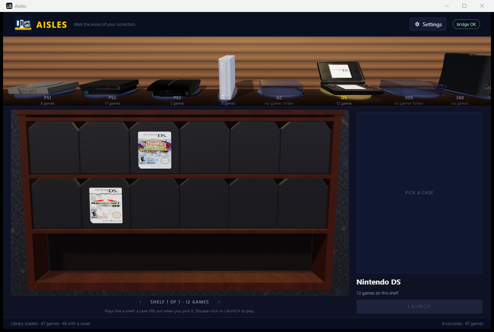

# Phase 5: true-scale media, resolved artwork, and the shelf's look

The shelf and the hero now draw from the same physical model. A 120 mm disc in the
hero is the same 120 mm disc on the shelf, a DS card has its real 33 × 35 mm body, and a
jewel case is landscape at 142 × 125 × 10 mm. Artwork is resolved once on the host,
cached, and served to both views. This pass also settles the room's exposure and adds
the workshop's idle medium turn.

## One table, two views

`wwwroot/media.js` is the only place the physical presets live:

| Preset | Case (mm) | Medium (mm) |
|---|---:|---|
| Jewel | 142 × 125 × 10 | 120 × 1.2 CD-ROM |
| DVD | 135 × 190 × 14 | 120 × 1.2 DVD-ROM |
| Blu-ray | 135 × 171.5 × 13 | 120 × 1.2 Blu-ray |
| DS | 122 × 135 × 15 | 33 × 35 × 3.8 game card |
| 3DS | 122 × 135 × 14 | 35 × 33 × 3.8 game card |
| Xbox 360 | 135 × 190 × 14 | 120 × 1.2 DVD-ROM |
| GameCube | 135 × 190 × 14 | 80 × 1.2 miniDVD |

The shelf renders at `SHELF_UNIT = 0.0022`; the hero uses the workshop's
`HERO_UNIT = 0.01` (1 unit = 100 mm). The same `buildCase`, `buildDisc` and
`buildCartridge` functions are used in both, so a case cannot be one shape in the hero
and another on the shelf. Covers are fitted to the inlay aspect with a centre crop
(`fitTexture`); they are never stretched. Spines and backs are generated from the same
cover.

On the shelf the **object is the media itself**: a closed case for disc platforms, the
card for DS/3DS. The furniture is derived from that object rather than from a fixed
template — `slot = width × 1.05`, tier headroom `0.10 × height`, panels `0.14 × height`,
boards `0.07 × height`, plinth `0.165 × height`, cornice `0.13 × height`, depth
`0.71 × height`, and a `1.27 × slot` gap between bays. One bay is always three tiers of
six; the pager only appears when the console has more than 18 games. The shelf slides
with an ease-out cubic over `SLIDE_MS` (400 ms), snaps exactly to the bay centre, and
pre-renders the incoming bay before the slide. Selection survives the page: its slot
keeps a dashed `OUT` outline and the hero keeps the selected game.

## The hero

The hero shows the closed case at the real inlay size and the disc/card beside it at
real size, separated by `GAP_MM = 14`. The camera is fixed and fitted to the group; there
is no orbit or zoom. The case is never opened, nothing is inserted, and there is no
flicker between selections: the canvas persists, and the scene renders on selection,
resize and while the idle turn runs.

The medium has a slow idle turn borrowed from the workshop's **Spin media** control. A
disc turns in its own plane at `0.55 rad/s` (the workshop's speed), so its label reads
like a record. A DS/3DS card sways ±`0.30 rad` on its vertical axis instead of making a
full revolution: the workshop could show the back, but the hero's job is to keep the
label readable. `prefers-reduced-motion` stops both, and the turn stops while the
document is hidden. Only the medium moves; the case stays still.

## Artwork

The host owns resolution (`Domain/ArtworkResolver.cs`), so the web layer only receives
URLs. Precedence is:

1. a manual choice;
2. artwork beside the emulator or the game;
3. an online exact platform/serial match;
4. a normalized title + platform + region match;
5. generated artwork.

Local art is referenced in place and served through the `artwork.aisles.local` virtual
host; downloads go to `%LOCALAPPDATA%\Aisles\artwork`, keyed by the SHA-256 of the URL
and indexed per game with `SHA256(consoleId:fullPath)`. Online search runs **per selected
console**, once per session, in the background; it is not a global startup loop. Matching
strips a studio prefix (`Disney`, `Disney's`, `Disney/Pixar`, `Disney-Pixar`) before
normalization, which is what lets *A Bug's Life* meet LaunchBox's *Disney-Pixar A Bug's
Life*. The payload exposes the chosen source, the match rule used, and the source label
rectangle.

A cover is never treated as a disc or cartridge label. The hero shows a real label when
one resolves; otherwise it generates one from the same identity data. DS and 3DS shelf
cards show a **blank cartridge body** unless a real cartridge label is resolved — covers
do not print on cards. The two real DS labels in the shelf above (Cooking Mama 3 and
Mario Kart DS) come from the cartridge label path; the rest are intentionally blank.

## Light and colour

The first geometry captures were brighter than the workshop: the shelf's oak read
orange, the slatwall dominated the room, and the covers were competing with the
furniture. The levels now sit below the workshop's studio setup so the wood reads as
furniture and the printed media is the brightest thing in the room.

| | Before | After |
|---|---:|---:|
| Shelf exposure | 1.00 | 0.92 |
| Hero exposure | 1.05 | 0.96 |
| Console stage exposure | 1.04 | 0.96 |
| Shelf key / fill / rim | 2.30 / 0.72 / 0.42 | 2.00 / 0.60 / 0.34 |
| Hero key / fill / rim | 2.70 / 0.95 / 0.45 | 2.35 / 0.82 / 0.38 |
| Console key / fill / rim | 2.35 / 0.72 / 0.42 | 2.10 / 0.64 / 0.36 |
| Selected-console spot | 30 | 26 |
| Shelf wood tint | `#8c6244` | `#744c35` |

The slatwall and the carpet overlay were darkened at the same time; the carpet's warm
brown wash became a cool navy wash so its confetti no longer competes with the covers.
Covers are unlit, so they keep their printed brightness while the walnut and wall come
down around them.

## Verification

- `dotnet build Aisles.slnx -c Debug`: clean, 0 warnings, 0 errors.
- Settings tests: 11 assertions passed.
- Workshop tests: 13 passed.
- Live spin probe: PS1 disc on axis `z`, `0.661 → 1.828 rad` over ~2.1 s (`0.55 rad/s`);
  DS card on axis `y`, captured at `0.300 rad` (the sway limit).
- Live selections: PS1, PS2, PS3, DS and the empty GameCube shelf, at 2560 and 1280.
- 1:1 crops were used to confirm the covers, jewel-case proportions, DS label fitting
  and the `OUT` slot. WebView2 PrintWindow/CDP captures occasionally duplicate text at
  2560; that is a capture artifact only — the live surface is not tiled.

## Still open

- The hero's details rail: INFORMATION (game ID, region, emulator, shelf), PLAYED
  (value or a muted `—` with the reason) and ACHIEVEMENTS (the three Phase 6 states),
  with the hero stage shrunk so the blockout layout is matched.
- The Xbox 360 model still meets the right viewport edge at 1280.
- GameCube and 3DS console models; the DS/3DS blank-card recess polish.
- LFS before a remote; RetroAchievements remains Phase 6.
