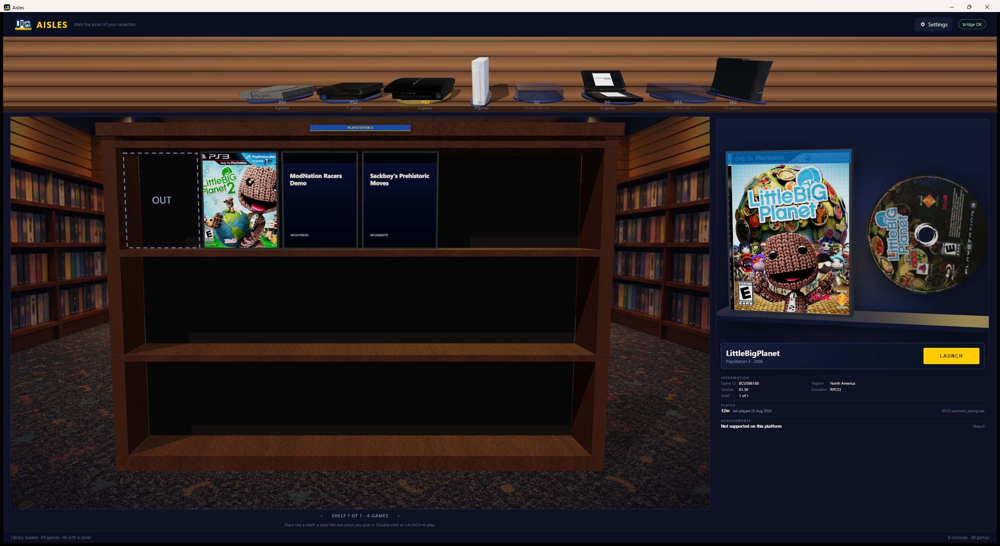
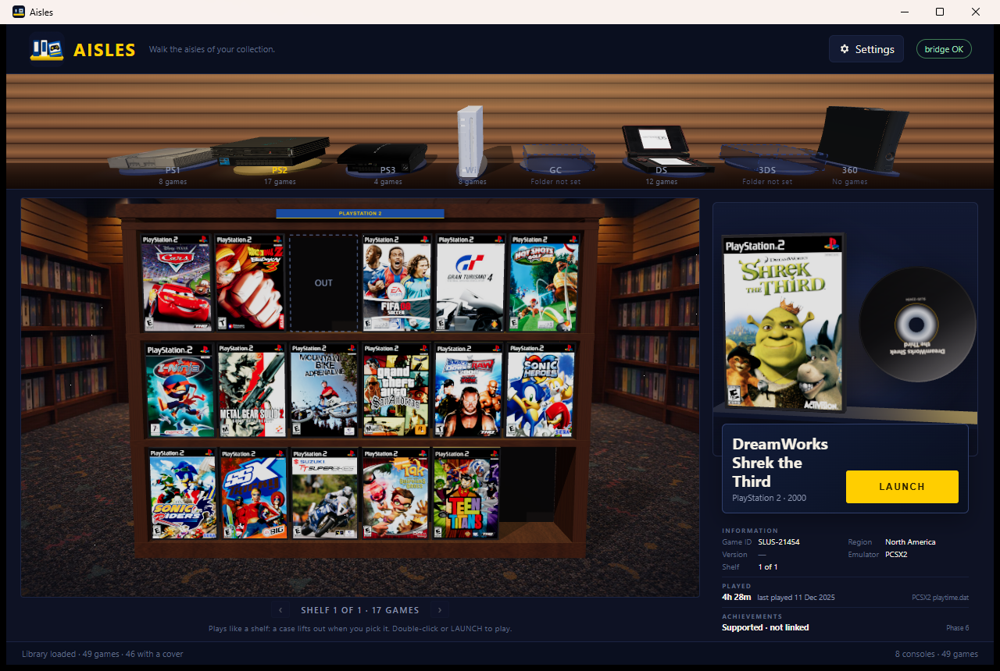
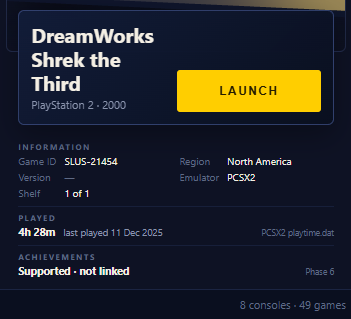
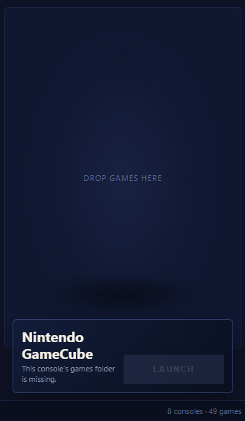
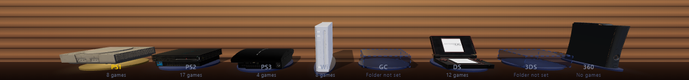
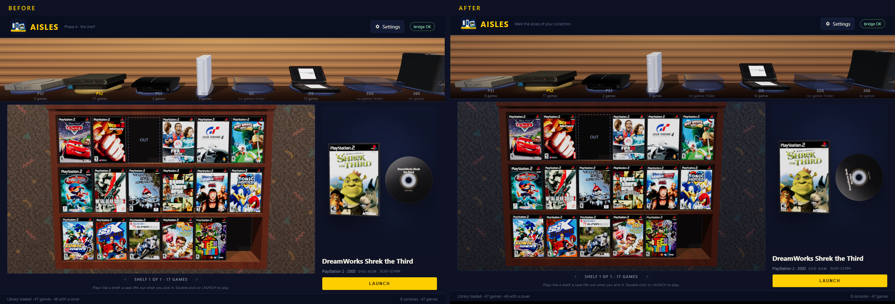

# Phase 5: true-scale media, resolved artwork, and the shelf's look

The shelf and the hero now draw from the same physical model. A 120 mm disc in the
hero is the same 120 mm disc on the shelf, a DS card has its real 33 × 35 mm body, and a
jewel case is landscape at 142 × 125 × 10 mm. Artwork is resolved once on the host,
cached, and served to both views. This pass also settles the room's exposure and adds
the workshop's idle medium turn.

The same window at 1280 × 860 — shop aisle behind the shelf, the platform plaque over
the bay, the head card with LAUNCH, and the rail under it:

## One table, two views

`wwwroot/media.js` is the only place the physical presets live:

| Preset | Case (mm) | Medium (mm) |
|---|---:|---|
| Jewel | 142 × 125 × 10 | 120 × 1.2 CD-ROM |
| DVD | 135 × 190 × 14 | 120 × 1.2 DVD-ROM |
| Blu-ray | 135 × 171.5 × 13 | 120 × 1.2 Blu-ray |
| DS | 135 × 122 × 15 | 33 × 35 × 3.8 game card |
| 3DS | 135 × 122 × 14 | 35 × 33 × 3.8 game card |
| Xbox 360 | 135 × 190 × 14 | 120 × 1.2 DVD-ROM |
| GameCube | 135 × 190 × 14 | 80 × 1.2 miniDVD |

The shelf renders at `SHELF_UNIT = 0.0022`; the hero uses the workshop's
`HERO_UNIT = 0.01` (1 unit = 100 mm). The same `buildCase`, `buildDisc` and
`buildCartridge` functions are used in both, so a case cannot be one shape in the hero
and another on the shelf. Covers are fitted to the inlay aspect with a centre crop
(`fitTexture`); they are never stretched. Spines and backs are generated from the same
cover.

On the shelf the object is always the **closed retail case**, including DS/3DS. The
playable disc or cartridge appears beside the selected case in the hero. The furniture
is derived from the case rather than from a fixed template — `slot = width × 1.05`,
tier headroom `0.10 × height`, panels `0.14 × height`,
boards `0.07 × height`, plinth `0.165 × height`, cornice `0.13 × height`, depth
`0.71 × height`, and a `1.27 × slot` gap between bays. One bay is always three tiers of
six; the pager only appears when the console has more than 18 games. The shelf slides
with an ease-out cubic over `SLIDE_MS` (400 ms), snaps exactly to the bay centre, and
pre-renders the incoming bay before the slide. Selection survives the page: its slot
keeps a dashed `OUT` outline and the hero keeps the selected game.

The DS and 3DS bays use their compact 135 × 122 mm case dimensions, so they remain
smaller than DVD cases while still reading as retail packaging.

## The hero

The hero shows the closed case at the real inlay size and the disc/card beside it at
real size, separated by `GAP_MM = 14`. The camera is fixed and fitted to the group; there
is no orbit or zoom. The case is never opened, nothing is inserted, and there is no
flicker between selections: the canvas persists, and the scene renders on selection,
resize and while the idle turn runs.

Title and LAUNCH share one card (`.hero-head`) that overlaps the bottom of the stage
rather than sitting below it, so the stage keeps the vertical space and the rail under it
never reflows when a title wraps or a platform has less data.

The medium has a slow idle turn borrowed from the workshop's **Spin media** control. A
disc turns in its own plane at `0.55 rad/s` (the workshop's speed), so its label reads
like a record. A DS/3DS card makes the workshop's full revolution on its vertical axis.
`prefers-reduced-motion` stops both, and the turn stops while the document is hidden.
Only the medium moves; the case stays still.

## The details rail

Below the title and LAUNCH, the hero keeps the blockout's three stacked sections. The
rail keeps a stable order and rhythm, so the hero stage takes the remaining space and the
row does not reflow when a platform has less data:

| Section | Contents |
|---|---|
| INFORMATION | Game ID, Region, Version, Emulator, Shelf (`1 of 1`, or `2 of 3` on a paged console) |
| PLAYED | duration and last-played date where the emulator stores them; otherwise muted `—` and the reason |
| ACHIEVEMENTS | *Supported · not linked* · *Not supported on this platform* · *Linked* with an earned/total bar |

Game ID and region come from the same identity the artwork resolver uses. A Wii or
GameCube game ID is read from the disc header on selection, so the rail can fill in before
the console's background artwork search finishes. `selectGame` now sends a small
`gameDetails` message; it replaces only the rail, never the 3D canvas, so the medium keeps
its current turn and the stage does not flicker.

The PLAYED row is fed by `Domain/PlayStatsReader.cs`:

- **PCSX2** `inis\playtime.dat` — fixed-width serial, seconds played, last-played Unix
  timestamp. Example: `SLUS-21454 16104 1765476516` → *4h 28m, last played 11 Dec 2025*.
- **DuckStation** `Documents\DuckStation\playtime.dat` — the same fixed-width line as
  PCSX2: serial, seconds played, last-played Unix timestamp.
- **Dolphin** `Config\TimePlayed.ini` — `[TimePlayed]` and `GAMEID = 0x…`. Dolphin's
  `TimePlayed::AddTime` stores `time_emulated.count()` in milliseconds, so the reader
  divides by 1000. Dolphin stores no last-played date.
- **RPCS3** `GuiConfigs\persistent_settings.dat` — `[Playtime]` maps a TITLE_ID to
  milliseconds and `[LastPlayed]` maps it to a local ISO 8601 date. Both are shown, so a
  first session reads like RPCS3's own list (*52s, last played 21 Nov 2025*).
  `config\games.yml` is only the disc-path registry and is not a play-time source.
- **DeSmuME, Citra and Xenia** store no play time. Their rows read `—` with the exact
  reason (for example, *DeSmuME does not record play time*), keeping the rail's height
  stable.

The PS3 shelf also includes installed HDD/PSN titles from `dev_hdd0\game`
(`CATEGORY=HG`, bootable) alongside the disc dumps. A title ID already registered as a
disc is skipped, so an installed update never becomes a second case. Version comes from
`APP_VER`, preferring the installed update over the disc's own value — which is why
LittleBigPlanet reads 01.30 rather than the disc's 01.01, matching RPCS3.

Achievements still stop at the Phase 6 boundary: the host marks PS1/PS2/GameCube/Wii as
*supported, not linked* and DS/3DS/PS3/360 as *not supported*. The linked branch and
progress bar are implemented so the layout is ready, but no account is read yet.

The empty state uses the same space for its hint instead of collapsing the hero:
`DROP GAMES HERE` sits in the stage, and the disabled LAUNCH stays in place.

## Artwork

The host owns resolution (`Domain/ArtworkResolver.cs`), so the web layer only receives
URLs. Precedence is:

1. a manual choice;
2. artwork beside the emulator or the game;
3. an online exact platform/serial match;
4. a normalized title + platform + region match;
5. generated artwork.

Local art is referenced in place and served through the `artwork.aisles.local` virtual
host; downloads go to `%LOCALAPPDATA%\Aisles\artwork`, keyed by the SHA-256 of the URL
and indexed per game with `SHA256(consoleId:fullPath)`. Online search runs **per selected
console**, once per session, in the background; it is not a global startup loop. Matching
strips a studio prefix (`Disney`, `Disney's`, `Disney/Pixar`, `Disney-Pixar`) before
normalization, which is what lets *A Bug's Life* meet LaunchBox's *Disney-Pixar A Bug's
Life*. The payload exposes the chosen source, the match rule used, and the source label
rectangle.

A cover is never treated as a disc or cartridge label. DS and 3DS shelf cases use
`frontCover`; the selected cartridge independently uses `cartridgeLabel`, so box art is
never printed onto the card. The hero shows a real cartridge sticker when one resolves;
otherwise it generates one from the same identity data. LaunchBox real-cartridge scans
in the measured DS scan family are cropped to their sticker before they are mapped to
the selected medium. The smaller 260 x 270 stock mockups stay blocked because their
label area contains resized box art rather than a genuine cartridge sticker.

## The room

The furniture stands in a shop instead of a void. The pack at
`wwwroot/art/retail-wood-v1/` supplies the surfaces and each layer is referenced where it
belongs:

| Surface | Where it comes from |
|---|---|
| Warm slatwall behind the console lineup | `console-slatwall-warm.svg` as the `.lineup` background |
| Shop aisle behind the shelf | `rental-store-perspective-v1.webp`, the bottom layer of `#shelf-canvas`'s CSS background, visible because the shelf renderer is built with `alpha: true` |
| Shelf boards | `oak-laminate.webp`, mapped in `shelf3d.js` with `color: 0x6f5847`, roughness `0.76`; backboards stay dark charcoal `#17110e` |
| Platform plaque over the selected bay | `category-<id>.png` in `#shelf-sign`, centred by `.shelf-sign` and re-pointed on every console change |

The plaque is a DOM image rather than a 3D plane, so it stays crisp at 2560 and never
z-fights the cornice. `renderShelfSign` shows it for the eight shipped platform ids and
hides it for anything else, so a custom console in `consoles.json` never wears another
platform's name.

## Light and colour

The first geometry captures were brighter than the workshop: the shelf's oak read
orange, the slatwall dominated the room, and the covers were competing with the
furniture. The levels now sit below the workshop's studio setup so the wood reads as
furniture and the printed media is the brightest thing in the room.

| | Before | After |
|---|---:|---:|
| Shelf exposure | 1.00 | 0.92 |
| Hero exposure | 1.05 | 0.96 |
| Console stage exposure | 1.04 | 0.96 |
| Shelf key / fill / rim | 2.30 / 0.72 / 0.42 | 2.00 / 0.60 / 0.34 |
| Hero key / fill / rim | 2.70 / 0.95 / 0.45 | 2.35 / 0.82 / 0.38 |
| Console key / fill / rim | 2.35 / 0.72 / 0.42 | 2.10 / 0.64 / 0.36 |
| Selected-console spot | 30 | 26 |
| Shelf wood tint | `#8c6244` | `#744c35` |

The slatwall and the carpet overlay were darkened at the same time; the carpet's warm
brown wash became a cool navy wash so its confetti no longer competes with the covers.
Covers are unlit, so they keep their printed brightness while the walnut and wall come
down around them.

## Verification

- `dotnet build Aisles.slnx -c Debug`: clean, 0 warnings, 0 errors.
- Settings tests: 37 assertions (settings, DS sticker preparation, PCSX2/DuckStation/
  Dolphin/RPCS3 parsing, and RetroAchievements support states).
- Workshop tests: 13 passed.
- Live spin probe: PS1 disc on axis `z`, `0.661 → 1.828 rad` over ~2.1 s (`0.55 rad/s`);
  DS card on axis `y`, `0.386 → 1.540 rad` over ~2.1 s, confirming the full revolution.
- Live details rail: PS2 showed *4h 28m · last played 11 Dec 2025 · PCSX2 playtime.dat*;
  PS1 showed DuckStation's play time; PS3 and DS showed *Not supported on this platform*
  in the achievements row; Wii resolved `SW2E52` on selection and showed Dolphin's `1m`;
  the empty GameCube shelf showed *Drop games here*. The linked achievements branch was
  exercised at `12 of 40 · 240 pts · 30%`.
- PS3 scanner harness against the installed library: 4 games (2 disc dumps + 2 installed
  HDD titles), versions `01.30`/`01.33`/`01.00`/`01.00`, play time `12m`/`51s`/`7m`/`3m`
  and last-played dates matching RPCS3's list. Updates, the `_USER1` profile and the empty
  `TEST12345` folder were excluded.
- The console camera now pulls back by the front half-depth of the models, so the Xbox 360
  no longer meets the right edge at 1280; the row was checked at 2560 and 1280.
- Live selections: PS1, PS2, PS3, Wii, DS and the empty GameCube shelf, at 2560 and 1280.
- 1:1 crops were used to confirm the covers, jewel-case proportions, DS label fitting,
  the `OUT` slot and the rail. WebView2 PrintWindow/CDP captures occasionally duplicate
  text at 2560; that is a capture artifact only — the live surface is not tiled.
- **Evidence set refreshed from the final build.** All 15 shots in
  `artifacts/phase5/look/` were re-captured on 2026-10-20 at 16:39: each state selected
  over the WebView2 DevTools protocol (`aislesSelectConsole` / `aislesSelectGame`), the
  window set to 1280 × 860 or maximised (2576 × 1408 as printed), then
  `PrintWindow(PW_RENDERFULLCONTENT)` for full windows and a CDP clip for the rails and
  the console row. The two exposure comparisons are historical and were not re-shot.
- **Lineup labels clamped for short windows.** At 1280 × 860 the plinth projects low
  enough that the count line ran past `.lineup`'s `overflow: hidden` and read as sliced;
  `updateLabels` in `stage3d.js` now reserves `LABEL_MARGIN + height + LABEL_PAD` and
  lifts the block when it would not fit. Measured after the change: label bottom
  `207 px` inside a `211.8 px` lineup, with no movement at 2560. Re-shots at 1280 show
  both lines clear of the shelf rule.

## Still open

- GameCube and 3DS console models; the DS/3DS blank-card recess polish.
- LFS before a remote; RetroAchievements remains Phase 6, including the account link that
  fills the rail's linked state.
