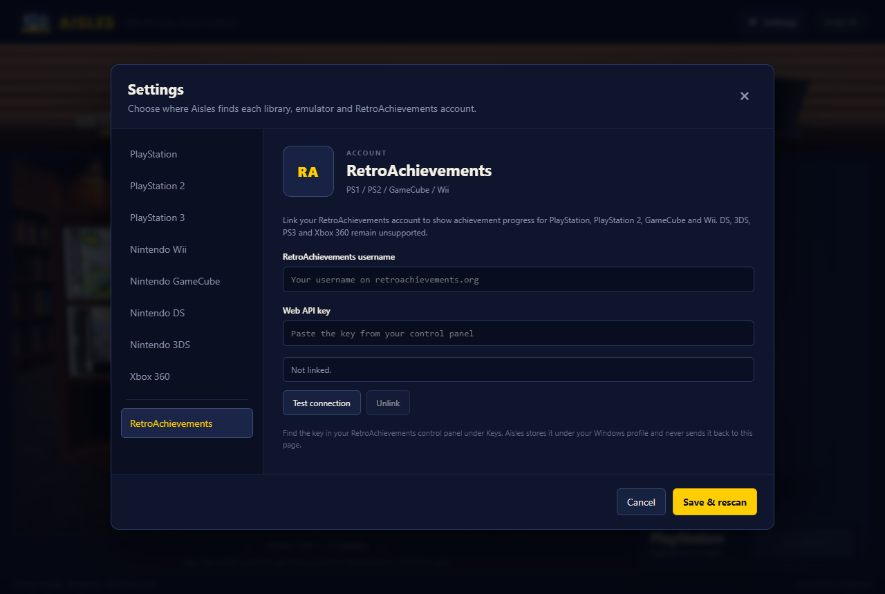
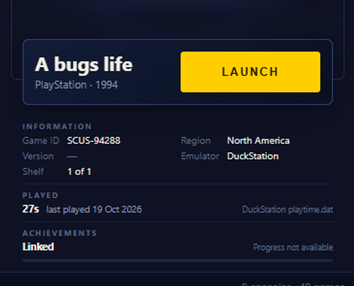
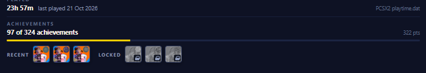

# Phase 6: RetroAchievements account and progress

Aisles now links one RetroAchievements account and fills the ACHIEVEMENTS row in the
game details rail for the platforms whose emulators support it. The account is optional:
with no credentials the rail keeps its original *supported, not linked* state, and
without a confident game match it says **Linked** without inventing `0 of 0`.

## Scope

| Console | Emulator | RetroAchievements |
|---|---|---|
| PS1 | DuckStation | supported; system ID `12` |
| PS2 | PCSX2 | supported; system ID `21` |
| GameCube | Dolphin | supported; system ID `16` |
| Wii | Dolphin | supported; system ID `19` |
| DS | RetroArch + melonDS DS / DeSmuME core | supported; system ID `18` |
| 3DS | Citra | not supported |
| PS3 | RPCS3 | RA not supported; trophies read locally (Phase 7) |
| Xbox 360 | Xenia | not supported |

The support boundary is the same one recorded in `PLAN.md` §3.4. It is enforced in
`Domain/RetroAchievementsSupport.cs`; no other table decides which platform can show
RetroAchievements progress. PS3 does not change this boundary: it is routed to the
separate local trophy provider described in `docs/phase7-ps3-trophies.md`.
DS support is descriptor-aware: selecting standalone DeSmuME or an incompatible
RetroArch core returns the rail to *not supported* instead of claiming support that
the active launch configuration cannot provide.

## Linking an account

**Settings → RetroAchievements** contains the username and web API key fields. The key
is the one generated in the RetroAchievements control panel under **Keys**; it is not the
account password.

- **Test connection** calls `API_GetUserProfile.php` and reports the account name and
  total points. Testing does not save anything.
- **Save & rescan** writes the account and refreshes the library so the rail picks up the
  new state.
- **Unlink** clears both the username and key; saving then removes the account file and
  returns the rail to *supported, not linked*.

Credentials live at `%LOCALAPPDATA%\Aisles\retroachievements.json`, beside
`settings.json`, with the schema version and only the username and key. The file is
deleted when the account is cleared, so no stale key is left behind. The key is never
returned to the web layer, written to logs, or committed to the repository. It is stored
in the user's Windows profile without additional encryption; the file relies on the
profile's normal filesystem permissions.

## How a game is resolved

The first pass deliberately avoids `rcheevos` hashing. The host matches a local game
against the cached RetroAchievements game list using two keys derived from the game title
and file name:

1. **Normalized name** — case, punctuation, accents, articles, studio prefixes
   (`Disney`, `DreamWorks`, `Nickelodeon`, `WWE`) and attached system suffixes
   (`PS2`, `GC`, `Wii`, etc.) are folded away.
2. **Compact name** — the same string with spaces removed.

An exact normalized title match wins. File names are the fallback, which is what lets
`GranTurismo4PS2.iso` meet *Gran Turismo 4* and `Shrek the Third (USA).iso` meet
*Shrek the Third*. A compact match is accepted only when the candidate is at least three
characters long. If two different RetroAchievements games tie for the best score, the
game is treated as ambiguous and left unmatched rather than showing another game's
progress.

Matching intentionally does not try to interpret abbreviations. `MGS2-PS2.ISO` is not
silently expanded to *Metal Gear Solid 2*. That remains future work, along with
`rcheevos` hashing if title matching proves insufficient across a larger library.

## API traffic and caches

| Request | Endpoint | Cache |
|---|---|---|
| Account test | `API_GetUserProfile.php?u=...` | none |
| System game list | `API_GetGameList.php?i=<system>&f=1&h=0` | `games-<systemId>.json` for 7 days |
| Game progress | `API_GetGameInfoAndUserProgress.php?g=<game>&u=...` | in memory for 5 minutes |

Requests are serialized and spaced at least 350 ms apart. A fresh game-list cache avoids
the request entirely; if the API is unavailable but a cached list exists, the stale list
is kept rather than blanking the rail. Progress is fetched only when a game is selected,
not while building the library payload. The same progress response supplies the badge
strip, so no separate per-achievement request is made. Matches stay in memory for 30
minutes and are cleared whenever the account changes.

The game-list cache lives under
`%LOCALAPPDATA%\Aisles\RetroAchievements\`. The API key is passed to the Web API as the
`y` query parameter required by RetroAchievements, and the username is also sent as `z`
and, where the endpoint expects it, `u`.

## Recent and next achievements

The aggregate row is followed by a compact badge strip. It shows the three most
recent unlocks for the selected game on the left (**RECENT**) and the first three
still-locked achievements in the game's display order on the right (**LOCKED**). The
per-achievement data comes from the same progress response that supplies the counts,
so the strip does not add a request.

Badges are the public images from `media.retroachievements.org`. Locked badges use
RetroAchievements' `_lock.png` asset, are desaturated, and carry a small lock mark so
they cannot be mistaken for unlocks. If an image is unavailable, the tile falls back
to the achievement's initial rather than leaving a broken image. Hovering a badge
shows its title, description, points, and unlock date or "Not unlocked yet".

The strip shows at most six achievements, not the full list; the game's own display
order is the only ordering the API exposes without inventing a "closest to earning"
score. Account-wide recent activity is intentionally out of scope because the rail
describes the selected game.

## Rail behaviour

The rail keeps its three RetroAchievements states and its stable height. PS3 adds the
two local states documented in `docs/phase7-ps3-trophies.md`:

| State | What the row shows |
|---|---|
| `notSupported` | *Not supported on this platform* + reason |
| `notLinked` | *Supported · not linked* + *Add account in Settings* |
| `linked` with progress | *N of M achievements* + earned points + filled progress track |
| `linked` with achievement details | the row above plus up to three recent and three pending badges |
| `linked` without progress | **Linked** + *Loading progress*, *No match* or *Unavailable* + empty track |
| `local` (PS3) | *N of M trophies* + *RPCS3 trophy data* + trophy badges, no aggregate points |
| `noTrophies` (PS3) | *No trophies* + why RPCS3 has no usable set |

The library payload carries the cheap state from the progress cache. Selecting a game
sends its local play/identity data immediately and refreshes achievements asynchronously,
so the 3D stage and the rest of the rail never wait on the network. A response is applied
only if its game is still selected.

If the API rejects the saved key, the service records the rejection and returns
`notLinked` with *Reconnect in Settings*. This prevents the rail from claiming progress
from an account that no longer authenticates. Correcting the key and saving clears the
rejection; a successful **Test connection** with the same saved credentials also clears
it.

## Verification

- `dotnet build Aisles.slnx -c Debug`: 0 warnings, 0 errors.
- Settings/domain tests pass, including account-file round-trip and removal, system IDs,
  matcher ambiguity and compact title matches, profile/game-list/progress parsing, disk
  cache reuse and stale-cache fallback, auth classification, offline and rate-limit
  handling, and the service's `notLinked`/`linked`/`notSupported` states.
- Workshop tests: 13 passed.
- Runtime, via the WebView2 DevTools protocol:
  - The Settings navigation and account editor rendered at the shipped window size.
  - **Test connection** reached the real RetroAchievements API with a deliberately
    invalid key and rendered *RetroAchievements rejected the saved username or web API
    key.* in the error state.
  - Saving those test credentials wrote the local account file, and the rail then flipped
    to *not linked* with *Reconnect in Settings* after the API rejected them.
  - **Unlink** plus save removed the file and restored *Supported · not linked*.
- The linked-without-progress rail state was exercised with a scripted `gameDetails`
  payload to verify the **Linked** row and empty track.
- A live linked account was verified with *SSX Tricky* on PS2: the rail showed
  **97 of 324 achievements**, **322 pts**, three recent unlocks, and three pending
  badges from the real API. All six badge images loaded at 64x64 and rendered at the
  shipped window size.
- The live app also resolved *Mario Kart DS* through the configured RetroArch melonDS
  core (**0 of 132 achievements**) and launched it with `-L "{core}" "{game}"`.
  Rapidly changing the selected PS2 game left the details rail on the second game,
  rather than applying the first game's response.
- No credentials or API keys are present in the repository. The automated tests use a
  fake `HttpMessageHandler`.

## Still open

- `rcheevos` hash matching for abbreviations, region variants and titles the normalizer
  cannot reconcile.
- Click-through achievement detail and a full achievement browser; the rail shows a
  six-badge sample with native tooltips.
- Optional refresh of the account's total points in Settings after the first test; the
  saved linked state currently does not persist a points snapshot.
