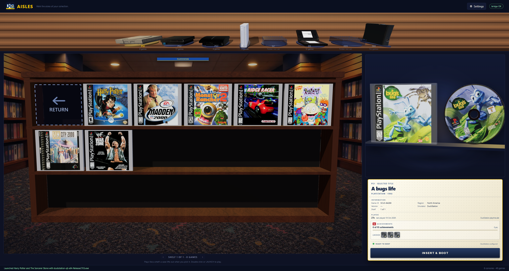

# Phase 8: Launch Deck

The selected game's 3D case and optical disc or cartridge remain in the fixed hero
stage. A separate card immediately below it now presents the game as a rental-store
checkout: identity, information, played history, achievements or trophies, emulator
readiness, and one explicit **Insert & Boot** action.

## Shared behavior

`launchDeck()` is the single selected-game renderer. Every platform therefore keeps the
same card geometry and stable details order. The game itself still supplies the accurate
platform, media, emulator and achievement provider:

| Game state | Card result |
|---|---|
| RetroAchievements supported | Progress, points, recent unlocks and locked badges |
| PS3 with a local trophy set | Trophy count and badges, labeled **PS3**, never **RA** |
| PS3 without a usable trophy set | *No trophies* plus the local RPCS3 explanation |
| Unsupported platform | The existing explicit unsupported state |
| Emulator unavailable | A red unavailable light and a disabled boot action |

The card has a positive `10px` gap below `.hero-stage`; it never uses a negative margin
or layers over a disc or cartridge. The hero remains the only 3D surface and the card
remains regular document layout, preserving the fixed camera and avoiding flicker.

## Verification

- `node --check src\Aisles.App\wwwroot\stage.js` passed.
- `dotnet build Aisles.slnx -c Debug --no-restore` passed with 0 warnings and 0 errors.
- Settings/domain tests and 13 artwork-workshop tests passed.
- Live WebView2 geometry check after selecting a PS1 game: `hero-stage.bottom = 895`,
  `launch-deck.top = 905`, confirming the 10px gap shown in the screenshot.
- The shared renderer was also exercised with PS2 RetroAchievements, DS RetroArch and
  PS3 local/no-trophy payloads; provider labeling and readiness stayed correct.
