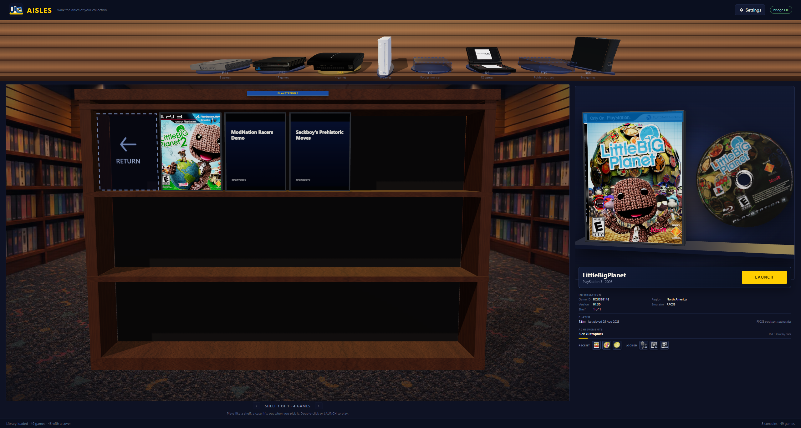

# Local PS3 trophies from RPCS3

Aisles now fills the ACHIEVEMENTS row for PlayStation 3 games using the trophy data
RPCS3 already keeps on disk. There is no PSN sign-in and no network request: the rail
reflects the emulator's local record, including partial progress and unlock dates.



## Scope

| Console | Emulator | Achievement source |
|---|---|---|
| PS1 | DuckStation | RetroAchievements (unchanged) |
| PS2 | PCSX2 | RetroAchievements (unchanged) |
| GameCube | Dolphin | RetroAchievements (unchanged) |
| Wii | Dolphin | RetroAchievements (unchanged) |
| PS3 | RPCS3 | **local RPCS3 trophy files** |
| DS | DeSmuME | not supported |
| 3DS | Citra | not supported |
| Xbox 360 | Xenia | not supported |

RetroAchievements still has no PS3 support, so `RetroAchievementsSupport.IsSupported("ps3")`
stays `false`. PS3 is routed to a separate `Ps3TrophyService`; the two providers share the
payload shape, not a support flag.

## Where the data comes from

RPCS3 installs a trophy set the first time a game registers it:

```
dev_hdd0\
  home\<user>\trophy\<NPWR00000_00>\
    TROPCONF.SFM     trophy definitions (plain XML)
    TROPUSR.DAT      per-user unlock state (big-endian tables)
    TROP001.PNG …    trophy icons
  game\<TITLE_ID>\TROPDIR\<NPWR00000_00>\
    TROPCONF.SFM     definitions, when the game is installed
```

`Ps3TrophyReader` parses both formats directly:

- **`TROPCONF.SFM`** is XML despite the extension. Each `<trophy>` supplies `id`,
  `ttype` (`B`/`S`/`G`/`P`), `hidden`, and the localized `<name>`/`<detail>`.
- **`TROPUSR.DAT`** starts with magic `0x818F54AD` and a table directory. Type `6`
  entries hold the trophy ID at `+16`, the unlock flag at `+20`, and the unlock
  timestamp at `+40`.
- **Timestamps** are CellRtc microseconds since `0001-01-01`, so they are converted
  with `new DateTime(ticks * 10)`, not Unix seconds.
- **`TROPHY.TRP`** is the disc or installed package. Its `TROPCONF.SFM` supplies IDs,
  grades and hidden flags, and `TROP.SFM` supplies the names, so the reader merges
  both. When a game has not been launched and no user trophy folder exists, the
  package still shows the set with zero progress instead of claiming the game has no
  trophies.

The reader tolerates real-world mismatches. The local *LittleBigPlanet* set, for
example, has 70 definitions but only 48 progress records; missing records are treated
as locked, not as an error. Hidden trophies keep their name hidden until they unlock.

## Finding the right set

`Ps3TrophyService` resolves `dev_hdd0` in this order:

1. the folder beside the configured RPCS3 executable (portable install);
2. `%APPDATA%\rpcs3\dev_hdd0` (standard install);
3. the parent of `InstalledGamesPath` when it ends in `game`.

The trophy set comes from the installed copy under `dev_hdd0\game\<serial>` first,
then the game's own `TROPDIR`, then `<dev_hdd0>\game\<serial>`. The installed copy is
preferred because updates replace trophy sets; a disc's `TROPHY.TRP` can be older and
smaller than what RPCS3 has installed. Within that set, the user's `TROPCONF.SFM` is
preferred over the package because it matches `TROPUSR.DAT` and carries localized
names. The active user is the one whose `TROPUSR.DAT` was written most recently, with
`00000001` as the tie-break. Results are cached for five seconds and invalidated by
file size and write time.

## Rail behaviour

| State | What the row shows |
|---|---|
| `local` with progress | *N of M trophies* + *RPCS3 trophy data* + filled progress track |
| `local` with details | the row above plus up to three recent and three pending trophies |
| `local` with no progress yet | *0 of M trophies* + *RPCS3 has no trophy progress yet* |
| `noTrophies` | *No trophies* + why RPCS3 has no usable set |
| RetroAchievements states | unchanged: `linked`, `notLinked`, `notSupported` |

Trophy points in a badge tooltip are the fixed PSN values (bronze 15, silver 30, gold 90,
platinum 180). The row itself never shows an aggregate points total: RetroAchievements
points and PSN trophy levels are different scales, and adding them would be dishonest.

Icons are served through the WebView2 virtual host `trophies.aisles.local`, mapped to
RPCS3's `dev_hdd0\home` folder. A URL therefore names the user and trophy set:

```
https://trophies.aisles.local/00000001/trophy/NPWR00160_00/TROP001.PNG
```

If the PNG is absent, the badge falls back to its letter tile rather than showing a
broken image.

## Implementation

| File | Responsibility |
|---|---|
| `src/Aisles.App/Ps3Trophies/Ps3TrophyReader.cs` | TROPCONF, TROPUSR and TRP parsing; CellRtc conversion |
| `src/Aisles.App/Ps3Trophies/Ps3TrophyService.cs` | RPCS3 discovery, user/set lookup, caching, payload and icon URLs |
| `src/Aisles.App/MainWindow.xaml.cs` | routes PS3 to the local provider and maps the icon host |
| `src/Aisles.App/Bridge/LibraryPayload.cs` | adds optional `source` and `unit` to the achievements payload |
| `src/Aisles.App/wwwroot/stage.js` | renders `local` and `noTrophies` and updates the Settings copy |

## Verification

- `dotnet build Aisles.slnx -c Debug`: 0 warnings, 0 errors.
- Settings/domain tests pass, including synthetic `TROPCONF.SFM`, `TROPUSR.DAT` and
  `TROPHY.TRP` parsing, CellRtc dates, an end-to-end local trophy set, icon URLs,
  hidden trophy masking, and the `noTrophies` fallback. The tests assert that the PS3
  payload leaves aggregate points null.
- The real local set at `C:\Emulation\RPCS3\...\NPWR00160_00` (LittleBigPlanet) resolves
  to 3 of 70 trophies with recent unlocks on 2025-02-14 and 2024-11-07.
- The running app rendered that *LittleBigPlanet* rail with six locally hosted icons;
  *ModNation Racers Demo* exercised the real `noTrophies` fallback.

## Still open

- Choosing between multiple RPCS3 users in the UI. The service currently follows the
  most recently written progress file.
- PSN sync. Aisles only reports what RPCS3 has recorded locally; it never uploads or
  downloads trophies.
- Click-through trophy detail and a full trophy browser, matching the existing
  RetroAchievements rail limitation.
